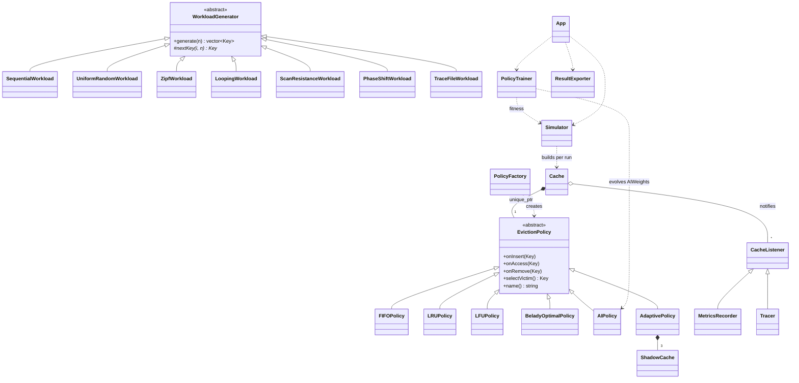

# Cache Eviction Simulator with an Evolved (AI) Eviction Policy

A C++17 project that compares cache-replacement policies (FIFO, LRU, LFU,
Belady's optimal, an adaptive meta-policy, and an **AI policy whose weights are
learned by a genetic algorithm**) on seven kinds of workloads, with step-by-step
tracing, CSV export, unit tests and benchmarks.

> **The short version:** the evolved policy learned an MRU-plus-frequency rule by
> itself. It comes within **0.4 %** of the theoretical optimum on loop workloads,
> where LRU, LFU and FIFO all score **0 %**. It ties LFU on scan resistance and
> scores about **12 points** above LRU on average on unseen test workloads. It also
> **loses** to LRU on phase-shift workloads and to LFU on Zipf. Section 7
> explains why.

> **Just want to run it?** Double-click **`CacheSim Studio.bat`** to open the program (it also adds a Desktop shortcut), or `run_windows.bat` to build, test and run the C++ engine. Simple steps: **[HOW_TO_RUN.md](HOW_TO_RUN.md)**.

| Folder / file | What it is |
|---|---|
| `HOW_TO_RUN.md` | simple step-by-step guide to build and run |
| `run_windows.bat` | double-click to build, test and run the C++ engine, then open CacheSim Studio |
| `CacheSim Studio.bat`, `web/` | **CacheSim Studio**: the desktop program (Simulator, Live Race, AI Lab, results) with the **Ask CacheSim** assistant |
| `docs/Project_Report.docx` / `.pdf` | 15-page project report |
| `docs/Presentation.pptx` / `.pdf` | 8-slide presentation |
| `include/`, `src/` | the simulator (≈ 2,600 lines of C++17, standard library only) |
| `tests/` | 43 doctest test cases, 10,900+ assertions |
| `results/` | every CSV and console output quoted in this README and the report |
| `weights.txt` | the AI weights learned by the GA (used by `--compare-all`) |

---

## 1. Overview, features, tech stack

**What it does.** A `Cache` stores key/value pairs up to a fixed capacity. When
it is full, it asks a swappable `EvictionPolicy` which key to drop. The
`Simulator` replays a request trace through the cache and records hits, misses,
evictions and timing. All policies see exactly the same trace, so the comparison
is fair.

**Features**
- 7 policies: FIFO, LRU, LFU (O(1)), **AI** (full-scan), **AI-K8** (Redis-style sampled), **Adaptive** (shadow caches), **Belady-OPT** (offline upper bound)
- 7 workloads: sequential runs, uniform random, Zipf(α), looping, scan-resistance, phase-shift, trace file
- Genetic-algorithm trainer: tournament selection, elitism, BLX blend crossover, decaying Gaussian mutation, parallel fitness with `std::async`, training on set A and testing on unseen set B
- Console tables, `results.csv`, `results_pivot.csv`, `training_curve.csv`, `generalization.csv`, `benchmark.csv`
- Step-by-step trace mode, an interactive menu and a full command line
- Tests clean under AddressSanitizer + UBSan, with 0 bytes leaked
- **CacheSim Studio** desktop program: a Simulator workspace, a live policy race, an AI Lab with weight sliders and an in-app genetic algorithm, all results as charts
- **Ask CacheSim** assistant (Claude Haiku 5.5 via the official Anthropic SDK; low effort, thinking off, 500-token answers, 6-message memory; the user's key stays on their PC)

**Tech stack:** C++17 · standard library only · CMake ≥ 3.15 (+ Makefile fallback) ·
doctest 2.4.11 (vendored) · ASan/UBSan · clang-format · gnuplot (optional) ·
builds on g++ ≥ 9, clang++ ≥ 10 and MSVC 2019+.

**Design patterns used (labelled in the code)**

| Pattern | Where | Why |
|---|---|---|
| **Strategy** | `EvictionPolicy` + 6 subclasses | swap the algorithm at runtime (`Cache::setPolicy`) |
| **Factory** | `PolicyFactory`, `WorkloadFactory` | callers depend only on the interface. A new policy needs one new class plus one line |
| **Template Method** | `WorkloadGenerator::generate()` → `nextKey()` | the base class fixes reseed → prepare → loop. Subclasses only choose keys |
| **Observer** | `CacheListener` ← `MetricsRecorder`, `Tracer` | measurement and logging do not clutter the cache |

---

## 2. UML class diagram




---

## 3. Folder structure and build files

```
cache-sim/
├── CMakeLists.txt  Makefile  README.md  HOW_TO_RUN.md  weights.txt
├── run_windows.bat  "CacheSim Studio.bat"
├── .gitignore            .clang-format
├── include/   Types.h EvictionPolicy.h FIFOPolicy.h LRUPolicy.h LFUPolicy.h
│              BeladyPolicy.h AIPolicy.h AdaptivePolicy.h Cache.h Metrics.h Tracer.h
│              Workload.h Workloads.h Simulator.h PolicyFactory.h PolicyTrainer.h
│              ResultExporter.h Cli.h
├── src/       one .cpp per header + main.cpp
├── tests/     test_main.cpp TestUtil.h test_fifo.cpp test_lru.cpp test_lfu.cpp
│              test_cache.cpp test_workloads.cpp test_trainer.cpp
├── data/      sample_trace.txt (10k requests)  tiny_trace.csv
├── results/   results.csv results_pivot.csv training_curve.csv generalization.csv
│              evaluation.csv benchmark.csv + console outputs (*.txt)
├── web/       index.html app.js engine.js chat.js styles.css data.js icon.ico
│              vendor/chart.umd.min.js (Chart.js 4.4.1, MIT), vendor/anthropic-sdk.min.js (@anthropic-ai/sdk 1.8.0, Apache-2.0)
├── scripts/   launch_studio.ps1  plot.gp  run_all.sh  run_all.bat
├── docs/      Project_Report.docx/.pdf  Presentation.pptx/.pdf  figures/*.png
└── third_party/ doctest.h (v2.4.11, MIT)
```

`CMakeLists.txt` builds a `cachesim_core` library, the `cache_sim` executable and
`unit_tests` (registered with CTest). `-DCACHESIM_SANITIZE=ON` turns on
ASan + UBSan. MSVC gets `/W4 /permissive-`. Everyone else gets
`-Wall -Wextra -Wpedantic`. The `Makefile` provides `all`, `test`, `asan`,
`run`, `format` and `clean`.

---

## 4. Code tour (each file is commented)

| File | Responsibility |
|---|---|
| `EvictionPolicy.h` | Strategy interface. Copy and move are deleted to prevent slicing (rule of five) |
| `FIFOPolicy` | `list` + `unordered_map<Key, iterator>`. `onAccess` is a no-op |
| `LRUPolicy` | same structures. `list::splice` moves a node to the front in O(1) without allocating |
| `LFUPolicy` | `unordered_map<Key,{freq,iter}>` + `map<int, list<Key>>` buckets + `minFreq`. LRU tie-break within a bucket |
| `BeladyPolicy` | `nextUse[]` built backwards in O(n). `set<(nextUse,key)>`, where the max element is the victim. Validates that it is fed the same trace |
| `AIPolicy` | dense `vector<Entry>` + index map (swap-and-pop removal). 4 normalised features, linear score, argmax. `sampleK` gives the O(K) variant |
| `AdaptivePolicy` | 3 experts (FIFO/LRU/LFU). Each has a *shadow* keys-only cache that scores a sliding window, plus a *real* instance that tracks the actual residents and names the victim |
| `Cache` | owns data + `unique_ptr<EvictionPolicy>`. Rejects capacity 0. Times `selectVictim()`. Notifies listeners |
| `Workload*` | Template Method base + 7 generators. Every generator reseeds `std::mt19937_64`, so the traces are reproducible |
| `Simulator` | builds a fresh `Cache` per run and times it with `steady_clock` |
| `PolicyTrainer` | the GA (section 5). Fitness is evaluated in parallel and the result is deterministic for any thread count |
| `ResultExporter` | console table (with *gap to OPT*) and CSV writers |
| `WebExporter` | `--export-web`: writes `web/data.js` (results, step-by-step traces, the AI's per-item scores via an `onBeforeEvict` Observer hook) for CacheSim Studio |
| `web/engine.js` | the same policies in JavaScript for CacheSim Studio; on start-up it replays the C++ traces and must match all 36 hit counts |
| `web/chat.js` | the Ask CacheSim assistant: official Anthropic SDK, `claude-haiku-5-5`, `output_config.effort: "low"`, thinking disabled, `max_tokens: 500`, last 6 messages, streaming |
| `Cli` / `App` | argument parser, interactive menu, and the use cases compare / trace / train / evaluate / benchmark |

---

## 5. Complexity analysis

n = cache capacity (resident keys), K = sample size, T = trace length, F = number of distinct frequencies.

| Policy | access (hit) | insert | select victim | remove | space | notes |
|---|---|---|---|---|---|---|
| FIFO | O(1) | O(1) | O(1) | O(1) | O(n) | list + hash map |
| LRU | O(1) | O(1) | O(1) | O(1) | O(n) | `splice` instead of erase/insert |
| LFU | O(1)* | O(1)* | O(1) | O(1)* | O(n) | *bucket lookup in `std::map` is O(log F). F is tiny, so it is effectively constant. An `unordered_map` makes it strictly O(1) |
| AI (full scan) | O(1) | O(1) | **O(n)** | O(1) | O(n) | exact argmax over all residents |
| AI-K (sampled) | O(1) | O(1) | **O(K)** | O(1) | O(n) | approximate. K=8 by default |
| Adaptive | O(1) × 3 | O(1) × 3 | O(1) | O(1) × 3 | O(n) × 6 | three real + three shadow structures, plus an O(W) window |
| Belady-OPT | O(log n) | O(log n) | O(1) | O(log n) | O(T + n) | O(T) preprocessing of next-use indices. **Offline only** |

**Accuracy and speed, honestly measured** (`results/benchmark.csv`, Zipf 0.9, 200k requests):

| capacity | 64 | 512 | 4096 |
|---|---|---|---|
| LRU (M req/s) | 8.71 | 8.68 | 7.78 |
| AI full scan | 1.87 | 0.30 | **0.04** |
| AI-K8 sampled | 4.99 | 5.42 | 5.04 |

The full scan gets ~200× slower as the cache grows, while sampling stays flat.
The price of sampling is accuracy. With K = 8 the "worst" key is found only
among 8 random candidates, so on Zipf(0.9) AI-K8 scores 38.5 % against 46.1 %
for the full scan. On phase-shift it scores *higher* (81.4 % vs 73.7 %),
because the random sampling dampens a bias in the learned weights. Redis makes
the same trade-off with its approximated LRU and LFU.

---

## 6. Build and run (Windows first)

### Windows
**Easiest:** double-click `run_windows.bat`. It finds Visual Studio (via `vswhere`) or MinGW `g++` by itself, builds without CMake, runs the tests and the comparison, exports the app data and opens CacheSim Studio. See [HOW_TO_RUN.md](HOW_TO_RUN.md).

*Visual Studio 2019/2022:* use **File > Open > Folder** (CMake is detected automatically), or run:
```bat
cmake -S . -B build
cmake --build build --config Release
ctest --test-dir build -C Release
build\cache_sim.exe --compare-all
```
*MinGW-w64 (MSYS2):* `cmake -S . -B build -G "MinGW Makefiles" && cmake --build build`.


### Linux (g++ ≥ 9)
```bash
sudo apt install build-essential cmake        # once
cmake -S . -B build -DCMAKE_BUILD_TYPE=Release
cmake --build build -j
ctest --test-dir build --output-on-failure
./build/cache_sim --compare-all
```
No CMake? `make && make test && ./build/cache_sim --compare-all`. You can also check for leaks with
`valgrind --leak-check=full ./build/unit_tests`.

### Command line
```
cache_sim                         interactive menu
cache_sim --compare-all           all policies x all workloads (default when only options are given)
cache_sim --train                 GA -> weights.txt + results/training_curve.csv   (~17 s on 8 cores)
cache_sim --evaluate              train set A vs unseen test set B
cache_sim --benchmark             million requests/second at capacity 64 / 512 / 4096
cache_sim --trace --capacity 3    step-by-step log (classic reference string)
cache_sim --export-web            refresh web/data.js (the data CacheSim Studio shows)
cache_sim --capacity 100 --workload zipf --alpha 1.1 --n 500000 --policy lfu
cache_sim --workload trace --trace-file data/sample_trace.txt
```
`scripts/run_all.sh` regenerates every file in `results/`. Run `gnuplot scripts/plot.gp` to draw the charts.

---

## 7. Sample output and analysis

`./build/cache_sim --compare-all` (capacity 50, 100,000 requests, seed 42). The full output is in `results/compare_output.txt`. `*` marks the best online policy.

```
Workload: looping   (capacity 50)
  policy            hits    misses    hit %  evictions  ns/request  gap to OPT
  ----------------------------------------------------------------------------
  FIFO                 0    100000     0.00      99950       128.0      81.62%
  LRU                  0    100000     0.00      99950       123.2      81.62%
  LFU                  0    100000     0.00      99950       130.2      81.62%
* AI               81266     18734    81.27      18684       160.1       0.36%
  AI-K8            79391     20609    79.39      20559        77.5       2.23%
  Adaptive             0    100000     0.00      99950       554.5      81.62%
  Belady-OPT       81624     18376    81.62      18326        85.8           -
```

Hit ratio (%) for every workload (`results/results_pivot.csv`):

| workload | FIFO | LRU | LFU | AI | AI-K8 | Adaptive | **OPT** |
|---|---|---|---|---|---|---|---|
| sequential | 4.09 | 4.14 | **4.81** | 4.19 | 4.45 | 4.21 | 23.94 |
| uniform | 10.01 | 10.02 | 9.99 | **10.27** | 10.11 | 9.97 | 38.96 |
| zipf(0.9) | 31.11 | 35.83 | 48.00 | 46.07 | 38.51 | **48.05** | 58.70 |
| looping | 0.00 | 0.00 | 0.00 | **81.27** | 79.39 | 0.00 | 81.62 |
| scan | 76.55 | 76.55 | **83.36** | 83.35 | 80.80 | 83.32 | 83.36 |
| phase | 73.24 | 84.78 | 48.69 | 73.65 | 81.37 | **87.59** | 91.49 |
| trace file | 51.84 | 55.29 | 47.54 | 50.99 | 54.78 | **55.73** | 63.94 |


**What the GA learned** (`weights.txt`): recency **−0.456**, frequency **−0.430**, age **+0.128**, gap **+0.317**.
Since the policy evicts the *highest* score:
- negative recency means it evicts the *most recently* used key, which is MRU-like behaviour.
- negative frequency means it protects frequently used keys, which is LFU-like behaviour.
- positive gap means it evicts keys whose accesses are far apart.

Nobody told it about MRU. It worked that out from the training workloads.

**When and why each policy wins**
- **Looping (loop = capacity + 20 %).** LRU always evicts exactly the key that is needed next, so LRU, FIFO and LFU all score 0 %. The evolved MRU-style rule keeps most of the loop resident and lands 0.36 points from optimal. Adaptive also scores 0 %, because none of its three experts can handle loops. An adaptive policy is only as good as its experts.
- **Scan.** One-time scan keys flush the hot set out of LRU and FIFO. LFU, AI and Adaptive keep the hot set and match OPT.
- **Zipf.** Popularity is stable, so frequency is the right signal. LFU and Adaptive win, and AI is about 2 points behind.
- **Phase shift — the evolved policy LOSES.** After the hot set moves, the old hot keys still have high counts, and the new hot keys are the *most recent*, so the learned anti-recency weight evicts them first. LRU (84.8 %) and Adaptive (87.6 %) clearly beat AI (73.7 %). LFU is the worst at 48.7 %.
- **Uniform and sequential.** There is no locality, so every online policy is within about 0.7 points of the others. Only OPT, which knows the future, does better.
- **Trace file (drifting hot set).** AI (51.0 %) loses to LRU (55.3 %) for the same reason as on phase shift.

**Generalisation** (`--evaluate`, mean hit ratio, `results/generalization.csv`):

| policy | train set A | unseen test set B |
|---|---|---|
| FIFO | 35.82 % | 38.79 % |
| LRU | 38.78 % | 42.01 % |
| LFU | 36.80 % | 37.50 % |
| **AI** | **54.19 %** | **53.88 %** |
| AI-K8 | 54.19 % | 56.46 % |
| Adaptive | 42.98 % | 45.84 % |
| Belady-OPT | 67.53 % | 71.23 % |

The train and test scores are almost equal (54.2 % vs 53.9 %), so the GA did not
overfit the training *traces*. It did learn the training *mix*. Because looping
is one of the five training workloads, an 80-point gain there outweighs a
10-point loss on phase shift. The fitness function decides what "good" means.

---

## 8. Tests

```bash
make test          # or: ctest --test-dir build
make asan          # same suite under AddressSanitizer + UndefinedBehaviorSanitizer
```
Result: **43 test cases, 10,923 assertions, all passing**. They are also clean under ASan + UBSan, and the leak check reports 0 bytes leaked.

| File | What is checked |
|---|---|
| `test_fifo/lru/lfu.cpp` | hand-traced capacity 3, sequence `1 2 3 1 4 2 5` → exact hits, misses and victims (FIFO 2/5 victims [1,2]. LRU 1/6 victims [2,3,1]. LFU 1/6 victims [2,3,4]). Also: capacity 1, single key repeated, LRU loop worst case, LFU tie-break, LFU scan resistance, `selectVictim` on an empty policy throws |
| `test_cache.cpp` | capacity 0 and a null policy are rejected. get/put/update semantics. Runtime policy swap. Empty workload. Capacity ≥ unique keys gives zero evictions. **Property checks** on 4 capacities × 7 policies: size ≤ capacity after every request, policy stays in sync with the cache, hits + misses = requests. **Belady ≥ every online policy** on 6 workloads × 3 seeds. Belady hand trace and trace-mismatch detection. AI weights (1,0,0,0) ≡ LRU and (0,0,1,0) ≡ FIFO (victim-for-victim). Features lie in [0,1]. Sampled with K ≥ n ≡ full scan. Adaptive beats LRU on scans. Listener removal |
| `test_workloads.cpp` | reproducibility, lengths, ranges, Zipf skew, looping pattern, sequential runs, scan keys used once, phase hot-set move, trace-file parsing (commas, comments, CSV header), errors for unknown names and missing files |
| `test_trainer.cpp` | weights save/load round trip and malformed files. History ordering best ≥ mean ≥ worst. Elitism means the best never decreases. Result ≥ the seeded LRU. Weights stay in [−1,1]. **Identical result with 1 or 4 threads**. Invalid configs are rejected |

---

## 9. Extension ideas
- **ARC**: two LRU lists (recency and frequency) plus ghost lists, with an adaptive split. This would fix the phase-shift weakness of LFU.
- **2Q / SLRU**: a probationary queue keeps one-time keys out of the main LRU and gives scan resistance at O(1).
- **CLOCK / CLOCK-Pro**: a reference-bit ring buffer. This is what operating systems use for page replacement.
- **W-TinyLFU** (Caffeine): a count-min-sketch admission filter in front of a small LRU window.
- **Richer AI**: add a ghost-history feature (recently evicted keys), a bias term, a decision tree, or a small neural network trained by imitation of Belady (as in LeCaR and LRB). Online re-training per phase.
- **Real traces**: ARC traces, MSR Cambridge, Twitter `cache-trace`, CDN logs (the `trace` loader already reads them).
- **Variable object sizes**: byte capacity and the GDSF/size-aware score.
- **GUI**: a Qt/ImGui live view of the cache contents, or a WebAssembly build for the browser.

---

## 10. Viva / interview Q&A

1. **Why is `EvictionPolicy` separate from `Cache`?**
   Single responsibility and the Strategy pattern. The cache owns the data and the policy only decides the victim. This keeps each policy small and testable, and lets us swap policies at runtime.

2. **Why are copy and move deleted in `EvictionPolicy`?**
   It is a polymorphic base class. Copying through a base reference would *slice* the object. Deleting all five special members except the virtual destructor makes misuse a compile error.

3. **Why does the base class need a virtual destructor?**
   `unique_ptr<EvictionPolicy>` deletes through the base pointer. Without a virtual destructor the derived destructor would not run, which is undefined behaviour and usually a leak.

4. **How is LRU O(1)?**
   A hash map gives O(1) lookup of the list node. `std::list::splice` relinks that node to the front in O(1), without allocating and without invalidating iterators. The victim is `back()`.

5. **How is LFU O(1)?**
   Frequency buckets (frequency → list of keys) plus a tracked `minFreq`. An access moves a key from bucket f to bucket f+1. If bucket f empties and was the minimum, `minFreq` becomes f+1. A new key always sets `minFreq` to 1.

6. **Why use `std::map` for the LFU buckets instead of `unordered_map`?**
   After an *arbitrary* removal the minimum must be recomputed, and with an ordered map that is just `begin()`. The cost is O(log F), and F (the number of distinct frequencies) is tiny.

7. **What is Belady's algorithm and why can't we use it in production?**
   It evicts the key whose next use is farthest in the future, which is provably optimal for demand caching. It needs the future, so it can only serve as an offline upper bound. The tests assert that it is ≥ every other policy.

8. **Is the GA really "AI"?**
   Yes. It is evolutionary computation, a classic branch of AI and machine learning (search and optimisation, à la Holland). It learns parameters from data by optimising an objective, which is what "learning" means. It is *not* deep learning: there are no gradients and no neural networks, and the model is 4 numbers you can read and interpret.

9. **Why a GA instead of gradient descent?**
   Hit ratio is a step function of the weights: a tiny change usually changes no decision, so the gradient is zero almost everywhere. A GA only needs to *evaluate* fitness, and the 4-dimensional search space is cheap to explore.

10. **How do you avoid overfitting?**
    Fitness is the mean over 5 different workload families, not one. We then evaluate on a test set B with different seeds *and* parameters. Train and test scores are 54.2 % and 53.9 %, which is a small gap.

11. **Why normalise features by the candidate maximum?**
    The score becomes independent of cache size and trace length, so weights learned at capacity 50 still make sense at capacity 4096. Only the *ordering* between candidates matters for the argmax.

12. **What does tournament selection give you over roulette selection?**
    It uses only ranks, so it is insensitive to fitness scale (all our fitnesses lie between 0.3 and 0.55). The selection pressure is tunable through k, and it is O(k) per pick.

13. **Why elitism?**
    It guarantees that the best fitness never decreases from one generation to the next, and the tests check this. Without elitism, a lucky best genome can be lost to crossover or mutation.

14. **Why does the mutation sigma decay?**
    Large steps early on explore, and small steps later fine-tune. It is a simple form of simulated-annealing-like scheduling (0.30 → 0.02).

15. **How is parallel fitness evaluation thread-safe without locks?**
    Every task builds its own `Simulator`, `Cache` and `AIPolicy`. The shared traces are read-only, and each task writes only to its own slots of the result vector. The results are identical for 1 or 4 threads, and a test checks this.

16. **Why can the evolved policy lose to LRU?**
    It optimises the *average* over the training mix. The anti-recency weight that wins on loops hurts when the working set moves (phase shift), because the new hot keys look "most recent" and get evicted first.

17. **Why does the Adaptive policy score 0 % on looping?**
    It can only choose among its experts (FIFO, LRU and LFU), and all three score 0 % on loops. A meta-policy cannot exceed its best expert.

18. **What is the trade-off of sampled eviction (AI-K8)?**
    It costs O(K) instead of O(n): about 5 M req/s at any capacity, against 0.04 M req/s for the full scan at 4096. In exchange it only finds the worst of K random keys. Redis uses the same idea.

19. **How is reproducibility guaranteed?**
    Every random source is a `std::mt19937_64` with a fixed seed. Workloads reseed on each `generate()` call. There is no global state, and the GA is deterministic across thread counts.

20. **How do you know there are no memory errors?**
    RAII is used everywhere (`unique_ptr`, containers), with no `new` or `delete`. The whole test suite runs under ASan + UBSan, and the leak check reports 0 bytes leaked.

21. **What happens with capacity 0?**
    It is rejected with `std::invalid_argument` by `Cache`, `Simulator` and the CLI (exit code 2 plus a usage message).

22. **Why measure decision time separately from ns/request?**
    ns/request includes hashing and list operations for every request. Decision time isolates `selectVictim()`, which is where the AI's O(n) cost lives.
